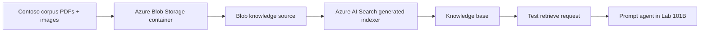

# 101A: Siapkan Corpus dan Foundry IQ Knowledge Base

Lab ini menyiapkan corpus fiktif Contoso Indonesia dan knowledge base Foundry IQ yang akan dipakai oleh prompt agent di lab berikutnya. Fokusnya portal-first: peserta mengunduh sample corpus dari situs ini, upload ke Azure Blob Storage, membuat knowledge source dan knowledge base, lalu menguji retrieval sebelum agent dibuat.


## Lab Details

| Level | Persona | Duration | Outcome |
| --- | --- | --- | --- |
| L100 | Business user / maker | 30-45 minutes | Corpus siap di Blob Storage, knowledge source dan knowledge base siap dipakai untuk grounded testing. |

## Why This Matters

Banyak demo chatbot gagal bukan karena modelnya buruk, tetapi karena knowledge source belum siap: dokumen tidak lengkap, tabel tidak terbaca, indexer gagal, atau sumber yang mirip bercampur. Lab ini sengaja mulai dari corpus dan retrieval supaya agent di lab berikutnya tidak hanya terlihat pintar, tetapi bisa dibuktikan grounding-nya.

## Introduction

Skenario: Contoso Indonesia ingin membuat asisten internal untuk menjawab pertanyaan karyawan tentang cuti, benefit, reimburse, dan alur approval. Peserta akan memakai corpus fiktif yang realistis: PDF policy, tabel panjang yang pecah halaman, flow chart, DOCX source, dan gambar form reimburse hasil generate image.

Di Microsoft Foundry, Foundry IQ menyediakan knowledge base yang dapat dipakai oleh agent. Azure AI Search menjadi retrieval infrastructure di belakangnya. Untuk pengalaman portal, kamu bisa bekerja dari Microsoft Foundry portal pada **Build > Knowledge** jika surface itu tersedia di tenant kamu, atau dari Azure portal pada **Azure AI Search > Agentic retrieval**. Screenshot resmi Microsoft Learn yang dipakai di lab ini berasal dari Azure AI Search portal karena saat ini dokumentasinya paling lengkap untuk knowledge source dan knowledge base.

> [!IMPORTANT]
> Status fitur harus dibaca jujur. Microsoft Learn menyatakan sebagian agentic retrieval API sudah GA, tetapi Azure portal dan Microsoft Foundry portal masih menyediakan akses preview-only untuk agentic retrieval features. Treat Foundry IQ via portal sebagai Preview/Partial GA untuk production decision.

## Core Concepts Overview

| Concept | Why it matters |
| --- | --- |
| Corpus | Kumpulan dokumen sumber yang akan menjadi dasar jawaban agent. Corpus yang buruk membuat agent mudah hallucinate. |
| Blob Storage container | Lokasi upload dokumen agar Azure AI Search dapat mengindeks file secara terkelola. |
| Knowledge source | Referensi reusable ke sumber data, misalnya Azure Blob Storage. Knowledge source memicu pipeline index, data source, skillset, dan indexer. |
| Knowledge base | Objek yang mengorkestrasi agentic retrieval dari satu atau beberapa knowledge source. |
| Vectorizer | Konfigurasi embedding model untuk mengubah teks menjadi vector yang bisa dicari secara semantic/hybrid. |
| Activity log / debug output | Bukti apakah query planning dan retrieval berjalan, sumber mana yang dipakai, dan apakah ada failure. |



## Documentation and Additional Training Links

- [What is Foundry IQ?](https://learn.microsoft.com/azure/foundry/agents/concepts/what-is-foundry-iq)
- [Quickstart: Agentic retrieval in the Azure portal](https://learn.microsoft.com/azure/search/get-started-portal-agentic-retrieval)
- [Agentic retrieval in Azure AI Search](https://learn.microsoft.com/azure/search/agentic-retrieval-overview)
- [Connect a Foundry IQ knowledge base to Foundry Agent Service](https://learn.microsoft.com/azure/foundry/agents/how-to/foundry-iq-connect)
- [Role-based access control in the Foundry portal](https://learn.microsoft.com/azure/foundry/concepts/rbac-foundry)

## Prerequisites

### Required

- Akses ke Microsoft Foundry portal dan Azure portal.
- Foundry project yang sudah tersedia.
- Azure AI Search service Basic tier atau lebih tinggi.
- Storage account dan Blob container, atau izin membuat container.
- Model embedding yang sudah deployed, misalnya `text-embedding-3-small` atau `text-embedding-3-large`.
- LLM deployment yang didukung portal untuk planning/answer generation, misalnya `gpt-4o`, `gpt-4o-mini`, `gpt-5`, `gpt-5-mini`, atau `gpt-5-nano`.

### Required RBAC

| Resource | Identity | Minimum role needed in this lab |
| --- | --- | --- |
| Azure AI Search | Your user | Search Service Contributor, Search Index Data Contributor, Search Index Data Reader |
| Blob Storage | Search service managed identity | Storage Blob Data Contributor |
| Foundry resource | Search service managed identity | Cognitive Services User |
| Foundry project | Your user | Foundry User or equivalent workshop role |

> [!TIP]
> Kalau workshop trainer sudah menyediakan Search service, storage container, model deployment, dan RBAC, peserta cukup mengikuti langkah upload dan portal setup. Kalau belum, minta owner subscription menyiapkan resource sebelum L100 dimulai; lab ini bukan provisioning lab.

## Summary of Targets

By the end of this lab, you will:

- Mengunduh atau menemukan corpus Contoso Indonesia.
- Upload file PDF dan gambar ke Blob container.
- Membuat blob knowledge source dari portal.
- Membuat knowledge base yang memakai LLM deployment untuk retrieval planning dan answer synthesis.
- Mengirim test query dan membaca citation/debug activity.
- Mengetahui failure umum sebelum lanjut membuat prompt agent.

## Use Cases Covered

| Use Case | Goal | Time |
| --- | --- | ---: |
| 1. Review dan upload corpus | Memastikan dokumen yang akan diindeks sesuai skenario | 10 min |
| 2. Create knowledge source | Menghubungkan Blob Storage ke Azure AI Search / Foundry IQ | 15 min |
| 3. Create dan test knowledge base | Memastikan retrieval dan citation bekerja sebelum agent dibuat | 20 min |

## Instructions by Use Case

## Use Case #1: Review dan upload corpus

### Objective

Upload corpus Contoso Indonesia ke Blob container agar siap diindeks oleh knowledge source.

### Summary of tasks

- Review file corpus yang akan diupload.
- Upload PDF policy dan gambar form/diagram ke Blob container.
- Catat container name untuk dipakai pada knowledge source.

### Step-by-step instructions

#### 1. Review corpus lokal

Buka folder [sample-data/contoso-indonesia](../../sample-data/contoso-indonesia/). Untuk Lab 101A, gunakan file berikut sebagai minimum corpus:

| File | Upload? | Why |
| --- | --- | --- |
| `pdf/HR-001-kebijakan-cuti-2026.pdf` | Yes | Lookup cuti dan entitlement table. |
| `pdf/HR-002-benefit-karyawan-2026.pdf` | Yes | Distinguish internet allowance vs device allowance. |
| `pdf/FIN-001-reimburse-dan-perjalanan-dinas.pdf` | Yes | Long table split across two PDF pages with repeated headers. |
| `assets/FORM-reimburse-scan.png` | Yes | Noisy visual / scanned-form example yang tetap terbaca. |
| `assets/DIAGRAM-proses-persetujuan.svg` | Optional | Flow/process visual generated from Mermaid source. |

Expected result: kamu tahu file mana yang akan masuk Blob container dan kenapa file itu ada di corpus.

> [!NOTE]
> DOCX di folder `docx/` adalah editable source untuk trainer/maintainer. Untuk indexing L100, mulai dari PDF dan image agar behavior lebih mirip dokumen enterprise yang biasa ditemukan di storage.

#### 2. Upload corpus ke Blob container

1. Buka [Azure portal](https://portal.azure.com).
2. Buka Storage account yang disediakan workshop.
3. Pilih **Data storage** > **Containers**.

   

4. Buat container baru, misalnya:

   ```text
   contoso-employee-corpus
   ```

5. Upload file minimum corpus dari langkah sebelumnya.

Expected result: container berisi minimal tiga PDF policy dan satu image form reimburse.

Troubleshooting:

| Symptom | Likely cause | Fix |
| --- | --- | --- |
| Upload button disabled | Tidak punya permission storage | Minta role Storage Blob Data Contributor atau gunakan container workshop. |
| File tidak muncul setelah upload | Filter folder atau refresh portal | Refresh container dan pastikan upload target benar. |
| Image tidak mau diupload | File terlalu besar atau format tidak didukung oleh policy tenant | Gunakan `FORM-reimburse-scan.png` yang sudah disediakan. |

## Use Case #2: Create knowledge source

### Objective

Membuat knowledge source yang menghubungkan Blob container ke Azure AI Search / Foundry IQ retrieval pipeline.

### Summary of tasks

- Buka Agentic retrieval / Knowledge sources.
- Pilih Azure Blob indexed source.
- Configure managed identity and vectorizer.
- Create knowledge source and wait for generated objects.

### Step-by-step instructions

#### 1. Buka knowledge source creation

1. Buka Azure AI Search service yang disediakan workshop.
2. Di left navigation, pilih **Agentic retrieval** > **Knowledge sources**.
3. Pilih **Add knowledge source** > **Add knowledge source**.

   

   

4. Pilih **Azure blob (Indexed)**.

   

Official Microsoft Learn screenshot:


Expected result: form knowledge source terbuka dan meminta nama, storage account, container, authentication, serta vectorizer.

> [!IMPORTANT]
> Screenshot ini dari Azure AI Search portal. Jika tenant kamu sudah memakai Microsoft Foundry portal **Build > Knowledge**, field-nya mungkin tampil dalam flow Foundry, tetapi konsepnya sama: pilih search service, pilih Blob source, pilih embedding model/vectorizer, lalu create knowledge source.

#### 2. Isi konfigurasi knowledge source

Gunakan nilai contoh berikut, sesuaikan dengan resource workshop:

| Field | Example value | Notes |
| --- | --- | --- |
| Name | `contoso-employee-ks` | Gunakan lowercase dan hyphen agar mudah dicari. |
| Source type | Azure blob (Indexed) | Bukan remote web source. |
| Storage account | Storage workshop | Pilih account tempat file diupload. |
| Container | `contoso-employee-corpus` | Container dari Use Case #1. |
| Authentication | Managed identity | Gunakan system-assigned identity bila workshop setup mendukung. |
| Vectorizer kind | Microsoft Foundry | Pilih project dan embedding deployment. |
| Embedding deployment | `text-embedding-3-small` atau deployment workshop | Harus sudah tersedia sebelum lab. |

Expected result: knowledge source berhasil dibuat dan portal mulai membuat generated objects seperti data source, skillset, index, dan indexer.

Troubleshooting:

| Symptom | Likely cause | Fix |
| --- | --- | --- |
| Storage account tidak muncul | Subscription/resource group salah | Cek directory/subscription di kanan atas Azure portal. |
| Managed identity auth gagal | Search service identity belum diberi Storage Blob Data Contributor | Minta admin assign role ke managed identity Search service. |
| Vectorizer tidak bisa disimpan | Embedding deployment tidak tersedia atau RBAC kurang | Pastikan embedding model deployed di Foundry project dan Search identity punya Cognitive Services User. |

## Use Case #3: Create dan test knowledge base

### Objective

Membuat knowledge base dari knowledge source, lalu menjalankan test retrieval sebelum membuat prompt agent.

### Summary of tasks

- Buat knowledge base.
- Pilih LLM deployment untuk query planning dan answer synthesis.
- Attach knowledge source `contoso-employee-ks`.
- Test dengan pertanyaan yang memaksa retrieval dari tabel dan flow.

### Step-by-step instructions

#### 1. Buat knowledge base

1. Di Azure AI Search service, buka **Agentic retrieval** > **Knowledge bases**.
2. Pilih **Add knowledge base** > **Add knowledge base**.

   

   

3. Isi name:

   ```text
   contoso-employee-kb
   ```

4. Pada **Chat completion model**, pilih **Add model deployment**.
5. Pilih **Microsoft Foundry**, subscription, project, dan LLM deployment yang tersedia.
6. Pada **Knowledge sources**, pilih:

   ```text
   contoso-employee-ks
   ```

7. Create knowledge base.

Expected result: knowledge base `contoso-employee-kb` berhasil dibuat dan siap dites.

Official Microsoft Learn screenshot:


Tenant screenshot:


Screenshot status: screenshot Microsoft Learn di atas menunjukkan shape umum form knowledge base. Screenshot tenant sendiri tetap perlu diambil via Playwright setelah login kalau ingin dokumentasi workshop menampilkan resource dan naming yang persis.

#### 2. Test retrieval dengan pertanyaan validasi

Kirim pertanyaan berikut di knowledge base playground/chat test:

```text
Berapa limit reimburse hotel untuk staff saat perjalanan dinas ke kota tier 1, dan dokumen apa yang menjadi sumbernya?
```

Expected result:

- Jawaban menyebut limit `Rp1.200.000/malam`.
- Jawaban mengarah ke dokumen `FIN-001-reimburse-dan-perjalanan-dinas.pdf`.
- Jika portal menampilkan citation atau references, citation harus menunjuk ke finance policy, bukan HR benefit.

Lanjutkan dengan pertanyaan kedua:

```text
Apakah intern mendapat internet allowance? Jelaskan berdasarkan dokumen benefit.
```

Expected result:

- Jawaban menyatakan intern tidak mendapat internet allowance.
- Source berasal dari `HR-002-benefit-karyawan-2026.pdf`.
- Agent tidak mencampur internet allowance dengan device allowance.

#### 3. Review activity/debug output

Jika portal menyediakan debug/activity icon, buka activity output dan cari bukti:

| Evidence | Why it matters |
| --- | --- |
| `modelQueryPlanning` | LLM membuat query plan untuk pertanyaan user. |
| `azureBlob` atau knowledge source call | Retrieval benar-benar memanggil Blob knowledge source. |
| `count` > 0 | Retrieval menemukan dokumen. |
| `elapsedMs` | Memberi gambaran latency retrieval. |
| References/citations | Memastikan jawaban grounded pada dokumen yang tepat. |

Expected result: minimal satu retrieval call mengarah ke knowledge source `contoso-employee-ks`.

#### 4. Review generated objects

Di Azure AI Search, buka **Search management** dan cek generated objects:

- Indexer: harus sukses atau memberi error jelas.
- Data source: harus menunjuk ke Blob container yang benar.
- Skillset: harus menunjukkan chunking/enrichment pipeline.
- Index: harus memiliki field searchable/vector yang dibuat otomatis.

Expected result: kamu bisa menjelaskan dari mana dokumen masuk, bagaimana diindeks, dan kenapa knowledge base bisa menjawab.

## Congratulations! You completed Lab 101A

Kamu sekarang punya corpus dan knowledge base yang siap dipakai di Lab 101B. Jangan lanjut membuat agent sebelum retrieval menjawab minimal dua pertanyaan validasi dengan source yang masuk akal.

## Test your understanding

- Kenapa corpus harus diuji sebelum agent dibuat?
- Apa bedanya knowledge source dan knowledge base?
- Role apa yang dibutuhkan Search managed identity untuk membaca Blob?
- Kenapa Teams/M365 publish tidak menjadi syarat di lab ini?
- Apa yang harus dicatat jika portal tidak menampilkan citation atau activity log?

## Challenge: Apply this to your own use case

Pilih satu proses internal di organisasi kamu, lalu tulis tiga dokumen minimum yang harus masuk corpus. Pastikan minimal satu dokumen memiliki tabel angka, satu dokumen memiliki flow approval, dan satu dokumen memiliki informasi yang mirip tetapi berbeda.

## Summary of learnings

- Retrieval quality dimulai dari corpus, bukan dari prompt agent.
- Foundry IQ knowledge base bisa memakai Azure Blob Storage sebagai source melalui Azure AI Search.
- Portal access untuk agentic retrieval harus diberi label Preview/Partial GA meskipun sebagian API sudah GA.
- Long table, image scan, dan process diagram harus masuk validation prompt supaya agent tidak hanya diuji dengan pertanyaan mudah.
- Knowledge base harus lolos smoke test sebelum dipakai oleh prompt agent di Lab 101B.

## Conclusions and recommendations

- Gunakan nama knowledge source dan knowledge base yang eksplisit, misalnya `contoso-employee-ks` dan `contoso-employee-kb`.
- Upload corpus kecil dulu, validasi retrieval, baru tambah dokumen lain.
- Simpan validation log sejak awal agar perubahan dokumen atau prompt bisa diuji ulang.
- Untuk produksi, minta owner tenant meninjau RBAC, data classification, Application Insights tracing, dan feature readiness sebelum pilot.