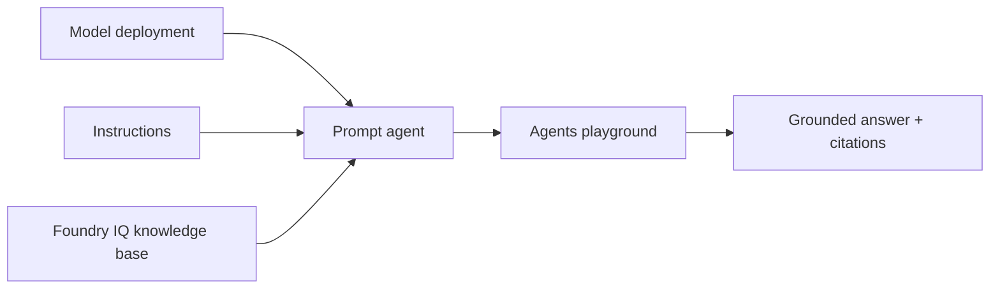

# 101B: Buat Prompt Agent dan Uji Grounded Answer

Lab ini membuat prompt agent portal-first dan menghubungkannya ke knowledge base dari Lab 101A. Fokusnya bukan membuat agent yang banyak fitur, tetapi membuat agent sederhana yang menjawab dari corpus dan menolak ketika informasi tidak ada.

## Lab Details

| Level | Persona | Duration | Outcome |
| --- | --- | --- | --- |
| L100 | Business user / maker | 35-45 minutes | Prompt agent menjawab pertanyaan dari corpus dan menampilkan citation di playground. |

## Table of Contents

- [Why This Matters](#why-this-matters)
- [Introduction](#introduction)
- [Core Concepts Overview](#core-concepts-overview)
- [Documentation and Additional Training Links](#documentation-and-additional-training-links)
- [Prerequisites](#prerequisites)
- [Summary of Targets](#summary-of-targets)
- [Use Cases Covered](#use-cases-covered)
- [Instructions by Use Case](#instructions-by-use-case)
- [Use Case #1: Create prompt agent](#use-case-1-create-prompt-agent)
- [Use Case #2: Attach knowledge base](#use-case-2-attach-knowledge-base)
- [Use Case #3: Test grounded answer](#use-case-3-test-grounded-answer)
- [Summary of learnings](#summary-of-learnings)

## Why This Matters

Prompt agent adalah jalur tercepat untuk membuat chatbot internal tanpa application code, container, atau runtime patching. Tetapi prompt agent tetap butuh boundaries: sumber data yang jelas, instruksi refusal, dan test prompts yang membuktikan jawaban grounded.

## Introduction

Di Lab 101A, kamu menyiapkan knowledge base. Di lab ini, kamu membuat agent **Asisten Karyawan Contoso** yang menggunakan model deployment dan knowledge base tersebut. Agent harus menjawab dalam Bahasa Indonesia, menyebut sumber saat tersedia, dan tidak mengarang kebijakan yang tidak ada di corpus.

## Core Concepts Overview

| Concept | Why it matters |
| --- | --- |
| Prompt agent | Agent deklaratif yang dikonfigurasi dari model, instructions, tools/knowledge, dan prompt. |
| Instructions | System behavior agent: scope, tone, refusal, citation expectation, dan escalation rule. |
| Tools / knowledge | Sumber data atau capability yang boleh dipakai agent untuk menjawab. |
| Playground | Tempat cepat untuk test multi-turn conversation dan iterasi instructions. |
| Save / version | Perubahan agent harus disimpan agar bisa diuji, dibandingkan, dan dipakai oleh endpoint/publish flow. |

### Diagram: Alur Prompt Agent ke Grounded Answer



Diagram ini menunjukkan tiga input utama prompt agent: model deployment, instructions, dan Foundry IQ knowledge base. Playground dipakai untuk membuktikan jawaban grounded sebelum lanjut ke validation gate.

## Documentation and Additional Training Links

- [What is Microsoft Foundry Agent Service?](https://learn.microsoft.com/azure/foundry/agents/overview)
- [Agent development lifecycle](https://learn.microsoft.com/azure/foundry/agents/concepts/development-lifecycle)
- [Microsoft Foundry Playgrounds](https://learn.microsoft.com/azure/foundry/concepts/concept-playgrounds)
- [What is Foundry IQ?](https://learn.microsoft.com/azure/foundry/agents/concepts/what-is-foundry-iq)
- [GPT-4.1 Prompting Guide](https://developers.openai.com/cookbook/examples/gpt4-1_prompting_guide)
- [Connect Agents to Foundry IQ Knowledge Bases](https://learn.microsoft.com/azure/foundry/agents/how-to/foundry-iq-connect)

## Prerequisites

- Lab 101A selesai, atau trainer menyediakan knowledge base siap pakai.
- Foundry project tersedia.
- Model deployment tersedia untuk prompt agent. Jika trainer memakai admin setup Terraform, gunakan deployment chat default `gpt-4.1` kecuali trainer memberi nama lain dari `terraform output model_deployments`.
- User punya role untuk create/manage agent, misalnya Foundry User atau role workshop yang setara.

## Summary of Targets

- Buat prompt agent baru.
- Pilih model deployment.
- Isi instructions yang membatasi jawaban ke corpus.
- Attach Foundry IQ knowledge base.
- Test dengan prompt yang membutuhkan tabel, process flow, dan refusal.

## Use Cases Covered

| Use Case | Goal | Time |
| --- | --- | ---: |
| 1. Create prompt agent | Membuat agent dan memilih model | 10 min |
| 2. Attach knowledge base | Menghubungkan agent ke corpus | 15 min |
| 3. Test grounded answer | Membuktikan answer/citation sebelum quality gate | 20 min |

## Instructions by Use Case

## Use Case #1: Create prompt agent

### Objective

Membuat prompt agent portal-first di Microsoft Foundry.

### Step-by-step instructions

1. Buka [Microsoft Foundry](https://ai.azure.com/).
2. Pastikan **New Foundry** aktif jika portal menampilkan toggle.
3. Pilih project workshop.
4. Buka **Build** > **Agents**.
5. Pilih **Create agent**.
6. Isi nama agent:

   ```text
   asisten-karyawan-contoso
   ```

7. Klik **Create**. Di **UI Foundry baru**, dialog quick-create **tidak menyediakan pilihan model** — portal otomatis men-deploy **model default** (mis. `o3` atau `grok`) sebagai bagian dari pembuatan agent.

Expected result: agent baru terbuka di agent builder / playground setup pane.

8. Di setup pane, **ganti model agent ke `gpt-4.1`** (deployment yang sudah disediakan admin). Ini menyamakan agent dengan standar lab dan menghindari ketergantungan pada model default yang ter-auto-deploy.

> [!IMPORTANT]
> Nama agent tidak selalu bisa diganti setelah dibuat. Gunakan nama yang stabil dan tidak mengandung data tenant/customer.

> [!WARNING]
> Kalau muncul `AuthorizationFailed ... Microsoft.CognitiveServices/accounts/deployments/write`, artinya identitas kamu belum boleh men-deploy model, padahal quick-create butuh itu. Membuat deployment adalah aksi admin. Untuk workshop ini, admin memberi peserta custom role least-privilege **Foundry Workshop Model Deployer** (hanya `deployments/read`+`write` di akun Foundry, via Terraform) agar auto-deploy berhasil. Kalau masih gagal: tunggu propagasi RBAC (±10 menit) lalu sign-out/in, atau minta admin. Setelah agent jadi, tetap **ganti modelnya ke `gpt-4.1`** untuk kontrol biaya.

Cost implication: membuat agent biasanya tidak mahal sendiri, tetapi test chat akan memakai token model. Jangan jalankan batch prompt besar di L100.

## Use Case #2: Attach knowledge base

### Objective

Menghubungkan prompt agent ke knowledge base Contoso dari Lab 101A.

### Step-by-step instructions

1. Di agent setup pane, buka bagian **Tools**, **Knowledge**, atau **Add tool** sesuai label portal kamu.
2. Pilih knowledge base yang dibuat di Lab 101A:

   ```text
   contoso-employee-kb
   ```

3. Pastikan agent hanya diberi tool/knowledge yang dibutuhkan untuk lab ini.
4. Save perubahan agent.

Expected result: agent setup menampilkan knowledge base Contoso sebagai sumber grounding.

Troubleshooting:

| Symptom | Likely cause | Fix |
| --- | --- | --- |
| Knowledge base tidak muncul | Project/Search connection berbeda atau indexing belum selesai | Cek project aktif dan knowledge base di Lab 101A. |
| Add tool gagal | RBAC kurang | Minta role Foundry User atau akses ke project/tool. |
| Agent tetap menjawab tanpa source | Instructions terlalu longgar atau knowledge belum attached | Save ulang setup dan retest prompt retrieval. |

## Use Case #3: Test grounded answer

### Objective

Menguji apakah agent menjawab dari corpus, bukan dari pengetahuan umum model.

### Step-by-step instructions

#### 1. Isi instructions

Gunakan instructions awal berikut. Struktur ini mengikuti guidance resmi OpenAI untuk GPT-4.1: instruksi dibuat eksplisit, memakai section Markdown, mengarahkan tool use secara jelas, dan menentukan output/citation behavior. Bagian knowledge retrieval mengikuti Microsoft Learn Foundry IQ guidance: agent harus memakai knowledge base tool, tidak menjawab dari pengetahuan umum untuk pertanyaan kebijakan, dan menyebut sumber bila tersedia.

```text
# Role and Objective
Anda adalah Asisten Karyawan Contoso Indonesia.

Tugas Anda adalah membantu karyawan memahami kebijakan internal berdasarkan knowledge base Contoso Indonesia.

# Instructions
- Jawab dalam Bahasa Indonesia yang jelas dan profesional.
- Untuk pertanyaan faktual tentang cuti, benefit, reimburse, perjalanan dinas, approval, atau kebijakan internal Contoso, gunakan knowledge base tool sebelum menjawab.
- Jangan menjawab pertanyaan kebijakan internal dari pengetahuan umum model.
- Kalau pertanyaan ambigu atau kurang detail untuk membentuk query yang tepat, minta klarifikasi ke user dulu sebelum memanggil tool. Jangan menebak atau mengarang argumen tool.
- Jika knowledge base tidak memiliki informasi yang cukup, katakan bahwa informasi tidak ditemukan di corpus dan sarankan menghubungi People Operations atau Finance Operations sesuai topik.
- Jangan membuat kebijakan baru, angka baru, atau pengecualian baru.
- Untuk pertanyaan proses atau alur (mis. proses pengajuan cuti, alur approval reimburse), sebutkan HANYA langkah yang benar-benar tertulis atau tergambar di sumber. Jangan menambah langkah, sistem, menu, nama aplikasi, atau tahapan yang tidak ada di corpus.
- Jika ada perbedaan istilah yang mirip, jelaskan perbedaannya dan sebutkan dokumen sumber jika citation tersedia.
- Untuk pertanyaan reimburse, bedakan nilai limit biaya, approval threshold, role, dan tier kota. Jangan memakai angka approval threshold sebagai limit biaya.
- Untuk topik data rahasia, ingatkan user agar tidak memasukkan data pelanggan, credential, token, atau informasi sensitif ke prompt.

# Response Steps
1. Pahami pertanyaan user dan tentukan apakah pertanyaan membutuhkan kebijakan internal Contoso.
2. Jika membutuhkan kebijakan internal, panggil knowledge base tool dengan query yang spesifik.
3. Untuk lookup tabel reimburse, ubah pertanyaan menjadi query berbentuk field/value agar retrieval memilih baris yang tepat. Contoh: `Tipe Biaya Hotel; Tier Kota Tier 1; Role Staff; kolom Limit. Jangan gunakan approval threshold. Berapa limitnya?`
4. Jawab hanya berdasarkan hasil retrieval. Untuk pertanyaan proses/alur, ikuti persis langkah pada sumber tanpa menambah tahapan.
5. Jika hasil retrieval tidak cukup, nyatakan keterbatasan tersebut dengan jelas.

# Output Format
- Jawab singkat dalam 1-3 paragraf.
- Cantumkan citation/source tepat setelah klaim faktual bila portal menyediakan citation.
- Untuk jawaban tidak ditemukan, gunakan format: "Informasi ini tidak ditemukan di corpus yang tersedia."
```

Expected result: instructions tersimpan dan agent siap diuji di playground.

#### 2. Run smoke test prompts

> Uji ini di **level agent**: kamu memvalidasi jawaban grounded, citation, dan **refusal yang jujur** — bukan retrieve mentah seperti Lab 101A. Lookup tabel hotel sudah dibuktikan di 101A. Validation set lengkap ada di Lab 101C.

Kirim prompt grounded (jawaban ada di corpus):

```text
Berapa hak cuti tahunan untuk karyawan tetap?
```

Expected result:

- Jawaban menyebut `12 hari per tahun` (saldo prorata untuk masa kerja di bawah 12 bulan).
- Citation mengarah ke `HR-001-kebijakan-cuti-2026.pdf` jika portal menampilkan citation.

Kirim prompt grounded kedua (istilah mirip — internet allowance vs device allowance):

```text
Berapa internet allowance per bulan dan siapa yang berhak menerimanya?
```

Expected result:

- Jawaban menyebut `Rp350.000 per bulan`, hanya untuk karyawan tetap dan kontrak yang bekerja hybrid atau remote dengan bukti tagihan, dan intern tidak berhak.
- Agent membedakan internet allowance (biaya langganan internet bulanan) dari device allowance (pembelian perangkat pendukung), sesuai `HR-002-benefit-karyawan-2026.pdf`.
- Ini sengaja menguji retrieval pada istilah mirip. Kalau agent tertukar internet vs device, perbaiki corpus atau prompt sebelum lanjut.

Kirim prompt refusal (topik yang memang **tidak ada di dataset**):

```text
Apa kebijakan parkir kantor untuk karyawan tetap?
```

Expected result:

- Agent tidak mengarang kebijakan parkir.
- Agent menyatakan informasi tidak ditemukan di corpus. Ini **benar dan diharapkan**: dataset memang tidak memuat kebijakan parkir kantor (`HR-002` mencatat "Tidak ada kebijakan parkir di dokumen ini"), jadi penolakan = lulus, bukan gagal.

Official Microsoft Learn playground visual:


> [!NOTE]
> Screenshot resmi di atas menunjukkan area playground dan metrics. Screenshot agent builder yang spesifik untuk tenant workshop masih perlu dicapture setelah route Foundry project stabil. Jangan pakai screenshot classic portal untuk mengklaim new portal UI jika labelnya berbeda.

## Congratulations! You completed Lab 101B

Kamu sudah punya prompt agent yang memakai knowledge base dan lolos smoke test dasar. Agent ini belum production-ready sampai Lab 101C menjalankan validation set penuh dan memilih active version.

## Test your understanding

- Apa peran instructions dibanding knowledge base?
- Kenapa agent harus menolak jika informasi tidak ada di corpus?
- Apa risiko membiarkan agent menjawab tanpa citation?
- Kapan kamu perlu memperbaiki corpus, bukan prompt?

## Challenge: Apply this to your own use case

Ambil satu policy internal lain dan tulis tiga prompt: satu lookup angka, satu pertanyaan proses, dan satu pertanyaan di luar scope. Prediksi dokumen mana yang harus dikutip agent.

## Summary of learnings

- Prompt agent adalah konfigurasi model, instructions, dan knowledge/tools.
- Grounded answer harus diuji dengan prompt yang memaksa retrieval dari corpus.
- Refusal behavior sama pentingnya dengan jawaban benar.
- Playground adalah tempat iterasi sebelum versioning dan publish.

## Conclusions and recommendations

- Mulai dengan instructions pendek tetapi tegas.
- Tambahkan knowledge source minimum dulu, lalu perluas setelah validation stabil.
- Simpan prompt test yang gagal untuk Lab 101C.
